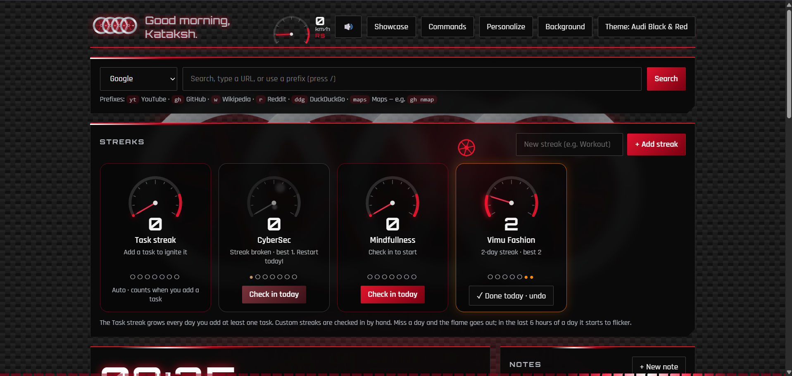
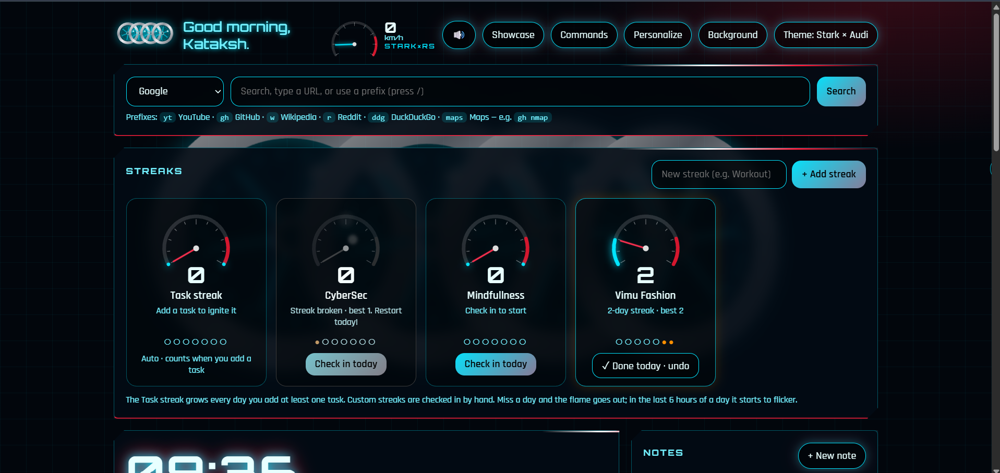
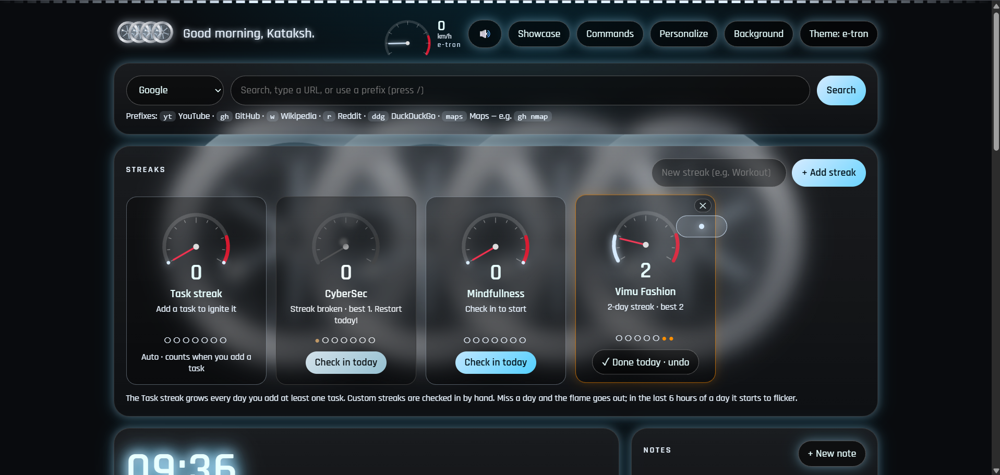

<p align="center">
  
</p>

<p align="center">
  <b>A single-file browser start page with a Tony Stark HUD look and an Audi-inspired theme set.</b><br>
  Spinning wheel-style rings · streak flames and rev gauges · AI assistant · task reminders · toolbox · per-theme sound and cursor effects
</p>

<p align="center">
  
  
  
  
</p>

> Everything runs in your browser. There is no server, no account and no build step. Open the file and it works.

---

## Screenshots

### Audi Black & Red
Carbon-fibre background, a red light line along the top of each card, a virtual-cockpit RPM dial in the header, and streaks shown as rev gauges. A red light also sweeps along the bottom edge of the page.



### Stark × Audi
The cyan Stark HUD grid with red accents and cut-corner panels.



### e-tron
Graphite glass cards, pill-shaped controls and an animated light bar across the top.



---

## Contents
- [Features](#features)
- [Themes](#themes)
- [Quick start](#quick-start)
- [Keyboard shortcuts](#keyboard-shortcuts)
- [Setting up the AI assistant](#setting-up-the-ai-assistant)
- [Privacy and network requests](#privacy-and-network-requests)
- [Known limitations](#known-limitations)
- [Tech](#tech)
- [Project layout](#project-layout)
- [Disclaimer](#disclaimer) · [License](#license)

---

## Features

### Productivity
- **Streaks:** an automatic **Task streak** (grows every day you add a task) plus up to 12 custom streaks you check in by hand.
  - Flame states: not started, burning, **flickering in the last 6 hours of the day**, and **black and empty with rising smoke** when broken.
  - In the Audi themes, streaks show as a **rev gauge** instead: the needle sweeps up with your streak, shakes in the red zone and a warning light blinks before a streak ends.
  - Spark bursts and a toast on milestone days.
- **To-do list with reminders:** due time, priority, snooze (+10 min), overdue highlighting, filters, plus a browser notification and a sound when a task is due.
- **Daily habits** with 7-day dots and streak counters.
- **Focus timer:** Focus, Short break and Long break with a progress ring. It keeps accurate time in the background, survives reloads, and the lengths are configurable.
- **Quick links:** add, edit, delete and drag to reorder, with site favicons.
- **Notes**, a **Today** card (daily goal plus day and year progress) and a live stats strip (open tasks, overdue, streak, next task).
- **Search bar** with an engine selector, URL detection and prefixes: `yt`, `gh`, `w`, `r`, `ddg`, `maps`, `g`.
- **Weather:** city search or geolocation, 3-day forecast, °C/°F.
- **Command palette** (`Ctrl/Cmd+K`) for links, tools, themes and settings.

### AI assistant (bring your own key)
- Works with **Anthropic (Claude)**, **DeepSeek**, or any **OpenAI-compatible** endpoint (OpenAI, OpenRouter, Groq, Gemini's compatibility endpoint, local **Ollama**).
- Streaming replies with code blocks and a copy button.
- Personalise it: assistant name, personality presets (Balanced, Concise, Productivity coach, Tech & security mentor, Creative partner), your own extra instructions, temperature and token limit.
- Optionally let it see your tasks, habits and notes. Quick actions such as **Plan my day** share them for that one message only.

### Toolbox
Calculator (supports `15% of 200` and `2^10`), stopwatch with laps, secure password generator, Base64 / URL / Hex / SHA-256 encoder, and a world clock with searchable time zones.

### Look and feel
- **9 themes that change structure as well as colour** (see [Themes](#themes)).
- **Four-ring emblem built from spinning wheels.** Wheel speed follows your task streak and hits top speed during focus sessions.
- **Virtual cockpit** in the header (Audi themes): an RPM dial and speed readout with an ignition needle sweep when the page loads.
- **Backgrounds:** arc reactor, starfield, code rain, neural net (reacts to the mouse), your own image (URL or upload) with brightness and blur, or plain.
- **Cursor effects that match the theme**, with click ripples. You can force one style or turn them off.
- **Per-theme sound effects**, synthesised with Web Audio (no audio files): start-up, hover, mechanical click, streak fire-up, streak break, showcase and theme switch.
- **Showcase mode** (`H`): hides all the UI and leaves only the animation.

### Your data
Everything is stored in your browser's `localStorage`. Use **Export data / Import data** in the footer to back up or move a JSON copy.

---

## Themes

| Theme | Look | Cursor | Sound |
|---|---|---|---|
| **Stark HUD** | Cyan arc-reactor HUD | Glow ring | Reactor hum and sci-fi chimes |
| **Mark III** | Red and gold, cut-corner armour plates | Hexagon, sparks | Servo whine, metallic clanks |
| **Audi Black & Red** | Carbon fibre, signal red, sequential light sweep | Spinning wheel, red comet trail | Deep RS engine start, heavy key click |
| **Stark × Audi** | Cyan HUD grid with red accents | Ring, mini Audi rings | Engine plus electric whine |
| **e-tron** | Graphite glass, light bar | Pill, light-bar streaks | Smooth electric rise, soft clicks |
| **Audi R8 V10** | Tango orange, angled cuts, RPM bar | Diamond, exhaust sparks | High-revving V10, sharp crackles |
| **Audi RS6** | Honeycomb grille, blue with red caliper accents | Hexagon, hex trail | Low V8 rumble, heavy thunk |
| **Audi Nuvolari** | Racing green and gold, waving chequered flag | Square, chequered squares | Vintage engine, bell dings |
| **Audi RS9** | OLED black, pixel grid, animated gradient edges | Square, pixels | Digital glitch blips, glass chimes |

Switch themes with the **Theme** button, the `D` key, or **Personalize**.

---

## Quick start

1. Download `index.html` (or the single file `newtab.html` if you got it separately).
2. Double-click it to open it in your browser.
3. Click **Personalize** to set your name, theme, cursor effect, sound volume and more.

### Use it as your new tab or home page
- **Firefox:** Settings → Home → set *Homepage and new windows* and *New tabs* to *Custom URLs* and enter the page address.
- **Chrome / Edge:** these browsers don't let you point the new tab page at a local file directly. Either set it as your **home page** (Settings → Appearance → *Show home button* → custom address), or use a new-tab redirect extension and give it the page address.

### Host it for free on GitHub Pages
1. Push this folder to a GitHub repository.
2. Go to **Settings → Pages**, choose your branch and the root folder, and save.
3. Your page will be at `https://<your-username>.github.io/<repo-name>/`.

> `localStorage` is per address. Data saved while using the file locally is **not** shared with the hosted copy. Use **Export data / Import data** to move it.

---

## Keyboard shortcuts

| Key | Action |
|---|---|
| `/` | Focus search |
| `Ctrl/Cmd + K` | Command palette |
| `T` | New task |
| `N` | New note |
| `A` | Add a quick link |
| `I` | Ask the AI |
| `D` | Cycle theme |
| `R` | Cycle background |
| `H` | Showcase mode (`H`, `Esc` or double-click to exit) |
| `M` | Sound on/off |
| `Space` | Start/pause the focus timer |

---

## Setting up the AI assistant

1. In the AI card, click **⚙ Configure**.
2. Pick a provider. The base URL and a default model fill in automatically:
   - **Anthropic:** `https://api.anthropic.com`
   - **DeepSeek:** `https://api.deepseek.com`
   - **OpenAI-compatible:** OpenAI `https://api.openai.com/v1`, OpenRouter `https://openrouter.ai/api/v1`, Groq `https://api.groq.com/openai/v1`, Ollama (local) `http://localhost:11434/v1`
3. Paste your API key (not needed for local Ollama) and check the model name. Model names change over time, so confirm them in your provider's docs.
4. Choose a personality, add any extra instructions, and click **Save**.

Notes:
- Your key is stored **in plain text in your browser's local storage**. Use a dedicated key with a spend limit. It is **never included in exports** and is removed by **Forget key** or **Reset all data**.
- Some providers block requests made directly from web pages (CORS). If you see "Couldn't reach the provider" with a correct key, use a provider that allows browser requests, or a small local proxy.
- For Ollama, start it with `OLLAMA_ORIGINS=*` so the page may connect.

---

## Privacy and network requests

The page has no analytics and no backend. Depending on what you use, your browser makes requests to:

| Service | Used for |
|---|---|
| Google Fonts | Orbitron and Rajdhani fonts |
| Google favicon service | Quick-link icons |
| Open-Meteo | Weather and city lookup |
| Your chosen AI provider | AI assistant messages |

Without internet, the page still works: you get system fonts and letter icons, but no weather or AI.

> **Before sharing screenshots:** they show your name, streak names and tasks. Crop or blur anything personal.

---

## Known limitations

- **Reminders only fire while the page is open** in a tab. A web page can't wake itself up after it is closed.
- Browsers only allow sound after you interact with the page, so the start-up sound plays on your **first click or key press**.
- Some browsers block notifications for pages opened from local files. You still get the in-page toast and sound. Hosting the page over HTTPS avoids this.
- Cursor effects are disabled on touch screens.
- The animated gradient edges (RS9 theme) and a few other effects need a recent browser version.

---

## Tech

Plain HTML, CSS and JavaScript in one file. No framework, no bundler, no external scripts.

- CSS variables for theming, `clip-path` for theme shapes, `@property` for animated gradient borders
- SVG for the rings, flames, gauges and cursor shapes
- Canvas for the animated backgrounds and cursor particles
- Web Audio API for all sound effects
- `localStorage`, the Notification API and the Fetch streaming API (for AI replies)

---

## Project layout

```
.
├── index.html                  # the whole app
├── README.md
├── LICENSE                     # add your chosen licence
└── assets/
    ├── banner.svg              # animated README banner (spinning wheels)
    └── screenshots/
        ├── audi-black-red.png
        ├── stark-x-audi.png
        └── e-tron.png
```

---

## Disclaimer

This is a fan-made personal project. It is **not affiliated with, endorsed by or sponsored by Audi AG, Marvel or Disney**. "Audi", the four-ring emblem, "Iron Man" and "Stark" are trademarks of their respective owners. The ring emblem here is a simple original drawing made from circles, not an official logo file. Car names are used only as a design theme.

## License

Choose a licence and add a `LICENSE` file, for example [MIT](https://choosealicense.com/licenses/mit/).

---

<p align="center">Made by <b>@your-github-username</b> · Issues and ideas are welcome</p>
